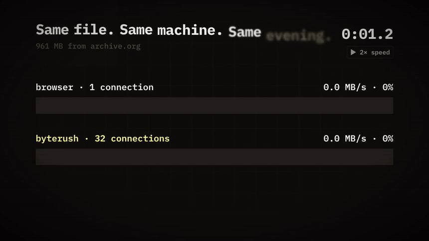
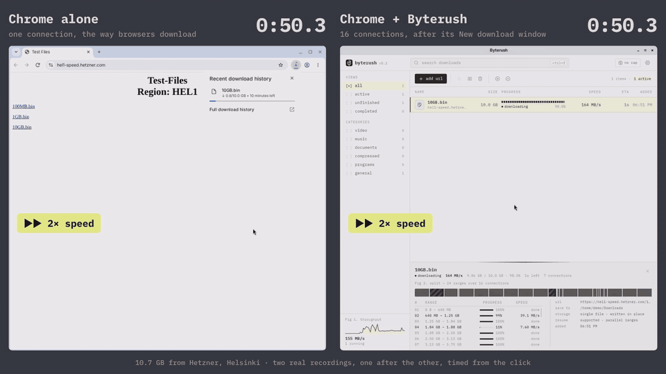
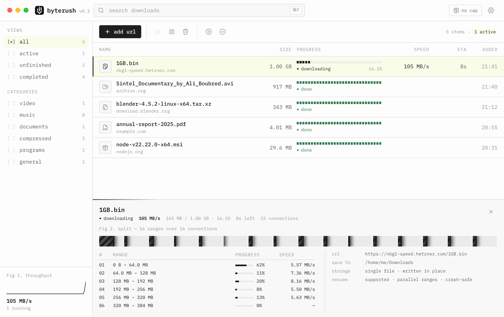

<p align="center">
  
</p>

<h1 align="center">Byterush</h1>

<p align="center">
  <b>The free, open-source parallel download manager.</b><br>
  Up to 32 connections per file, downloads that survive crashes and expired links,<br>
  and it takes over the downloads your browser starts.
</p>

<p align="center">
  <a href="https://github.com/zecod/byterush/actions/workflows/ci.yml"></a>
  <a href="https://github.com/zecod/byterush/releases/latest"></a>
  
  <a href="LICENSE"></a>
</p>

<p align="center">
  <a href="https://zecod.github.io/byterush-frontend/"><b>Website</b></a> ·
  <a href="#download">Download</a> ·
  <a href="#benchmarks">Benchmarks</a> ·
  <a href="#browser-extension">Browser extension</a> ·
  <a href="#how-it-works">How it works</a> ·
  <a href="CONTRIBUTING.md">Contributing</a>
</p>

<p align="center">
  <a href="https://zecod.github.io/byterush-frontend/#demo">
    
  </a>
  <br>
  <sub>▶ <a href="https://zecod.github.io/byterush-frontend/#demo">Watch the demo</a>: the click, the New download window, then Chrome alone against Chrome with Byterush · also on 10.7 GB: <a href="#10-gb-screen-recorded">10.4× faster</a></sub>
</p>

## Why Byterush

A browser downloads a file over **one** connection. Many servers, mirrors and CDNs cap how fast a single connection may go, and the further away a server is, the slower one TCP connection runs however fast your line is. Byterush asks for different byte ranges of the same file over many connections at once and writes each one straight into place, so together they use the bandwidth you pay for.

- **Much faster on real servers.** A 961 MB file from archive.org took **6 min 54 s** on one connection and **13.5 s** with Byterush: **30× faster**. A 10.7 GB file took **9 min 34 s** in Chrome and **55 s** with Byterush. A 3.6 GB file took **33 s**; one connection was still at 97% after 32 minutes when the server dropped it. [Benchmarks ↓](#benchmarks)
- **Nothing is lost.** Progress is synced to disk every few seconds; after a crash, a power cut or a reboot, downloads continue from where they were. An expired link? Start the download again in the browser and the same download carries on.
- **Your browser's downloads, caught.** The Chrome / Edge extension hands every download over with the browser's cookies, so sites that need a login or a bot check still work. A **New download** window pops up over the browser, like IDM's: name, size, folder, the room left on that drive, then start, later or cancel. If Byterush can't get the very same file, the browser simply keeps it.
- **Free and private.** MIT licensed, no account, no telemetry. The browser bridge only listens on `127.0.0.1`.

## Benchmarks

The same file, the same machine, the same evening: one connection (curl, which downloads the way a browser does) against Byterush with 8, 16 and 32 connections. Wall-clock time for the whole download, two runs per setting unless noted.

<picture>
  <source media="(prefers-color-scheme: dark)" srcset="docs/media/benchmark-dark.svg">
  
</picture>

| File | Server | 1 connection | Byterush 8 | Byterush 16 | Byterush 32 | Best |
|---|---|---:|---:|---:|---:|---:|
| 961 MB video | archive.org | 6 min 54 s | 28.4 s | 22.8 s | **13.5 s** | **30.7×** |
| 3.6 GB archive¹ | archive.org | > 32 min 13 s | — | — | **32.7 s** | **≥ 59×** |
| 62 MB video | archive.org | 48.9 s | 10.6 s | 8.6 s | **6.0 s** | **8.2×** |
| 1 GB test file¹ | Hetzner Nuremberg | 28.9 s | — | **6.0 s** | 6.5 s | **4.8×** |
| 10.7 GB test file² | Hetzner Helsinki | 9 min 34 s | — | **55.1 s** | — | **10.4×** |
| 10.7 GB test file² | Hetzner Falkenstein | 5 min 37 s | — | **50.1 s** | — | **6.7×** |

¹ One run per setting. The 3.6 GB file's single connection never finished: the server reset it after 32 min 13 s with 97% received, so that time and the speed-up are lower bounds.<br>
² Chrome against the Byterush app, screen-recorded on 24 Oct 2026 (below); one run each, both timed from the click, so Byterush's time includes about 4 s in its New download window. It downloaded at the VM's disk speed (210–230 MB/s): with a faster disk the gap is wider.

**What to expect.** The gain is largest where a server limits each connection (archive.org, many mirrors and file hosts) or sits far away. A server that doesn't limit connections still gains on big files (4.8× above), while small files gain less because the per-request round trips weigh more: 100 MB files from Hetzner gained 1.4–1.5×. When one connection already fills your line (a fast CDN next door), nothing can beat your own bandwidth and times come out the same.

Raw numbers: [`docs/benchmarks.json`](docs/benchmarks.json). Reproduce: `scripts/bench.sh <url> [runs]`, then `node scripts/bench-chart.mjs` redraws the chart. Measured on a Linux VM in a datacenter on 23 Oct 2026; your numbers depend on the server, the distance and your line.

Many small files are fast too: 500 files of 48 KB finish in **0.36 s** with three downloads at a time (`examples/bench_many`, against a local server).

### 10 GB, screen-recorded

Hetzner's 10.7 GB test file, clicked in Chrome twice, one take right after the other: once on its own, once with the extension handing it to the Byterush app (16 connections). From Helsinki, one connection managed about 19 MB/s; Byterush finished in **55.1 s** against Chrome's **9 min 34 s**. From Falkenstein, closer, Chrome took 5 min 37 s and Byterush 50.1 s. Byterush was writing as fast as the VM's disk allowed both times.

<p align="center">
  <a href="https://zecod.github.io/byterush-frontend/#demo">
    
  </a>
  <br>
  <sub>▶ Both 10 GB races in full, with the click and the New download window, on the <a href="https://zecod.github.io/byterush-frontend/#demo">website</a></sub>
</p>

## Features

<table>
<tr><td width="50%" valign="top">

**Speed**
- Up to 32 connections per download (16 by default)
- Dynamic re-splitting: a connection that finishes takes over half of the largest range still in progress, so every connection stays busy until the last byte
- The first request doubles as the size check: no extra round trip per file
- Global speed cap, one click to toggle

**Never lose a download**
- Progress checkpoints: the partial file is synced before its progress is recorded
- Downloads that were running continue when the app starts again
- Resume verifies the file didn't change on the server (size, ETag, Last-Modified)
- Expired links continue from a fresh link; refused extra connections step aside

</td><td width="50%" valign="top">

**Browser takeover**
- Chrome and Edge (Manifest V3) extension catches every download
- Replays the browser's cookies, user-agent and referer
- Falls back to the browser when the app can't get the same file
- Right-click → *Download with Byterush*; per-site on/off

**Organized**
- Queue with a limit on simultaneous downloads, *download later*
- Sorted into Video / Music / Documents / Compressed / Programs
- Batch downloads (`https://site/img*.jpg` with a numeric range)
- Clipboard monitor, temporary folder on a fast drive, light & dark theme

</td></tr>
</table>

<picture>
  <source media="(prefers-color-scheme: dark)" srcset="docs/media/app-dark.webp">
  
</picture>

## Download

Get the latest version from **[Releases](https://github.com/zecod/byterush/releases/latest)** or from the [website](https://zecod.github.io/byterush-frontend/#download), which picks the right file for your system.

| System | File |
|---|---|
| **Windows** 10 / 11 (x64) | `Byterush_<version>_x64-setup.exe` (installer) or `…_x64_en-US.msi` |
| **macOS** 11+ Apple Silicon | `Byterush_<version>_aarch64.dmg` |
| **macOS** 11+ Intel | `Byterush_<version>_x64.dmg` |
| **Linux** x64 and arm64 | `.AppImage` (any distribution), `.deb` (Debian, Ubuntu), `.rpm` (Fedora, openSUSE) |

Every release lists SHA-256 checksums in `SHA256SUMS.txt`. Until code signing is set up, macOS asks you to confirm the first launch (right-click the app → *Open*) and Windows SmartScreen shows *More info → Run anyway*.

## Browser extension

The extension in [`extension/`](extension) hands browser downloads to the app.

1. Install and start Byterush.
2. Add the extension from the **[Chrome Web Store](https://chromewebstore.google.com/detail/STORE_ID_TODO)**. Chrome, Brave and Vivaldi install it directly; Edge first asks to *allow extensions from other stores*; Opera needs its *Install Chrome extensions* add-on.
3. Pin it, and to catch private windows too: **Details → Allow in Incognito**.

In Byterush, **Settings → 03 · browser → set up the extension…** has the same steps with a button to the store, and turns green once the extension checks in; until then, the main window suggests it. The [setup page](https://zecod.github.io/byterush-frontend/setup.html) checks live that the extension is loaded and reaches the app, and lists why a download can stay in the browser.

Without the store (a managed browser, or offline), the same extension loads from a folder: it ships inside the app (the setup guide shows the folder with a copy button and opens the extensions page of each Chromium browser it finds) and as `byterush-extension-<version>.zip` on every release. Turn on **Developer mode** on the browser's extensions page, click **Load unpacked** and pick the folder. Publishing a new version to the store is described in [docs/CHROME_WEB_STORE.md](docs/CHROME_WEB_STORE.md).

How it decides: while Chrome is choosing the file name, the extension sends the download to the app together with the exact request headers Chrome used. The app opens its first connection and compares the answer with what the browser was getting (a web page instead of the file means a login or bot check; a different size means a different file). Only when it's the same file is Chrome's copy cancelled; otherwise Chrome carries on as if nothing happened. If you start a download again whose link had expired, the paused download in Byterush continues from the new link instead of starting over.

Then the **New download** window opens on top of the browser: the file's name and size, the folder it will be saved in (change it with the folder button), how much room is left on that drive, and the number of connections. **Start download** (or Enter) goes, **later** keeps it paused in the list, **cancel** drops it. Until you answer, the download waits with its first connection open, so a link that works only once still works; closing the window keeps the download for later. To start browser downloads without asking, untick *ask for every browser download* in the window or in **Settings → 03 · browser**.

**Leave small files to the browser** (off by default): in **Settings → 03 · browser**, *leave downloads smaller than 1 GB to the browser* (any size, in MB or GB) keeps quick downloads in the browser and hands over only the big ones. The extension skips files whose size it already knows; the app checks the others on its first response. Links picked with right-click → *Download with Byterush* are always taken.

When a download stays in the browser, you are told why: the extension's popup lists the last hand-overs with the reason, and the app shows a notice when it tried and couldn't (the server refused, a different file came back). A busy server (429, 502, 503, 504, or a dropped first connection) is asked again twice, after what it asks for in `Retry-After` up to three seconds, before the browser keeps the download.

It needs these permissions: `downloads` (to see and hand over downloads), `webRequest` + `cookies` (to replay your session for the same URL), `contextMenus`, `storage`, `alarms` (to check in with the app every 5 minutes, so the setup guide knows it is installed), and access to all sites (downloads can come from anywhere). It talks only to the app on `127.0.0.1:51723`, and the app accepts calls from this extension only (the store build and the folder's pinned id). The setup page can ask it one thing, whether it is installed and reaches the app (`externally_connectable`, limited to `zecod.github.io` and `localhost`). What it does with your data, in full: the [privacy page](https://zecod.github.io/byterush-frontend/privacy.html).

## How it works

1. **One request to start.** The first request asks for the whole file as an open range. Its answer tells the size and whether ranges work, and it keeps streaming as the first segment.
2. **Split.** The file is divided across the connections and written into one preallocated (sparse) file. On exFAT/FAT32, which have no sparse files, each range gets its own part file, joined at the end.
3. **Re-split.** When a connection finishes, it takes over the second half of the largest range still in progress, if that saves more time than a new connection needs to get up to speed.
4. **Checkpoint.** Every 4 seconds the data is synced to disk, then that progress is recorded in `state.json` (written atomically, with a backup from the last good start).
5. **Finish.** The file is moved or rebuilt under a temporary name and renamed into place.

Resuming goes straight for the first missing range; if the server's answer shows a different file, the download starts over instead of mixing two versions.

```
src-tauri/src/engine/   download engine (no Tauri dependency, fully tested)
  segments.rs           splitting and re-splitting
  download.rs           first request, part files, connections, checkpoints, finishing
  mod.rs                queue, persistence, speed meter
src-tauri/src/lib.rs    Tauri commands, UI updates, clipboard watcher
src-tauri/src/bridge.rs local HTTP bridge for the extension (127.0.0.1:51723)
src/                    React interface
extension/              Chrome / Edge extension
scripts/                benchmark, chart, extension end-to-end test, release helpers
```

The website and the demo videos live in [zecod/byterush-frontend](https://github.com/zecod/byterush-frontend).

## FAQ

<details>
<summary><b>Why did a download stay in the browser?</b></summary>

The app couldn't get the same file the browser was getting: the site answered with a web page (a login or bot check), a different size, a form submission (POST), or the app wasn't running. The extension's popup lists recent hand-overs with the reason.
</details>

<details>
<summary><b>I get "403 Forbidden".</b></summary>

Usually the link expired or needs your browser's session. Start the download again in the browser: Byterush continues the same download from the fresh link. Byterush also retries hotlink-protected files with the site's own referer and lowers the connection count on servers that refuse extra connections.
</details>

<details>
<summary><b>Is it really faster for every download?</b></summary>

No: when one connection already fills your line, nothing is faster than your own bandwidth. The gain comes from servers that limit each connection and from distance; see [Benchmarks](#benchmarks).
</details>

<details>
<summary><b>Where are my settings and the download list?</b></summary>

`%APPDATA%\com.byterush.app` on Windows, `~/Library/Application Support/com.byterush.app` on macOS and `~/.local/share/com.byterush.app` on Linux.
</details>

<details>
<summary><b>Firefox?</b></summary>

Not yet: the extension is Chrome/Edge (Manifest V3). The app itself works with any browser through copy-paste or the clipboard monitor.
</details>

## Build from source

Prerequisites: [Rust](https://rustup.rs) (stable), Node.js 22, and per system:

- **Windows**: Visual Studio C++ Build Tools (MSVC)
- **macOS**: Xcode Command Line Tools (`xcode-select --install`)
- **Linux** (Debian/Ubuntu): `sudo apt install libwebkit2gtk-4.1-dev libappindicator3-dev librsvg2-dev patchelf libxdo-dev build-essential`

```bash
npm install
npm run tauri dev                 # run the app
cd src-tauri && cargo test        # engine tests: crash and restart, file replaced on the server, connection caps, …
npm run tauri build               # installers in src-tauri/target/release/bundle
```

- `scripts/bench.sh <url> [runs]`: one connection against Byterush with 8, 16 and 32 connections.
- `CHROME=/path/to/chromium node scripts/extension-e2e.mjs`: the extension in a real Chromium against the real bridge and engine.
- The demo videos and this README's GIFs are rendered in [zecod/byterush-frontend](https://github.com/zecod/byterush-frontend) (`video/`).

Releases are built by GitHub Actions for every platform when a `v*` tag is pushed: see [`docs/RELEASING.md`](docs/RELEASING.md).

## Contributing

Bug reports, ideas and pull requests are welcome: start with [`CONTRIBUTING.md`](CONTRIBUTING.md). Security issues: please report them privately as described in [`SECURITY.md`](SECURITY.md).

## License

[MIT](LICENSE) © zecod and the Byterush contributors. Interface font: Geist (SIL Open Font License). Icons: [Hugeicons](https://hugeicons.com) free set. The demo videos are made with [Remotion](https://www.remotion.dev), which has its own license for companies.
